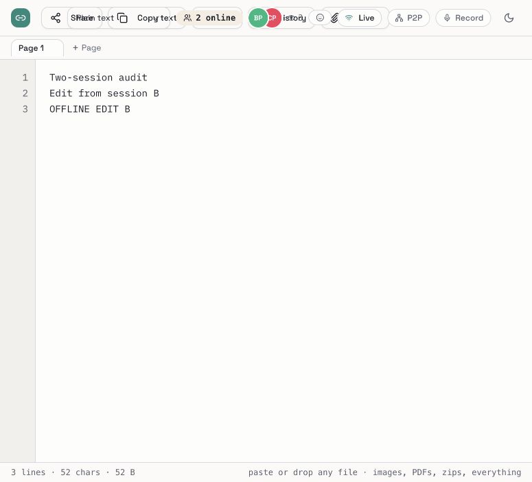
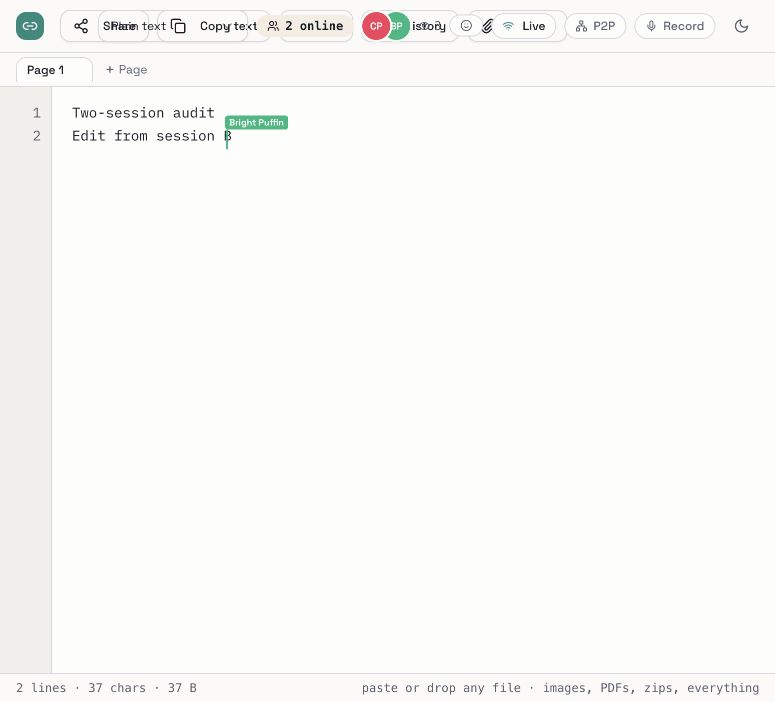
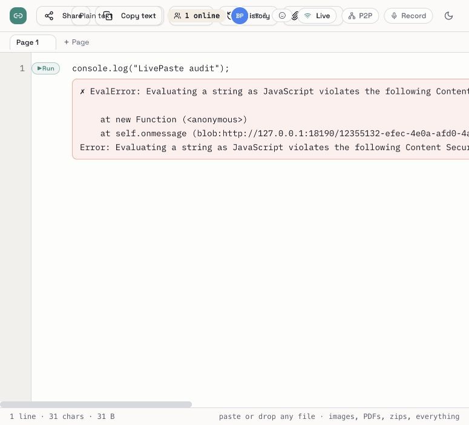

# LivePaste reliability audit and repair plan

Date: 12 November 2026. Audited version: 3.18.0.

**Repair status:** The 18 findings below have been addressed in the local
3.18.1 changes. This file preserves the original observations and release
baseline; its references to open reproductions and the untouched installation
describe the initial audit. See [REPAIR_REPORT.md](REPAIR_REPORT.md) for the
current fixes, passing checks, browser evidence and remaining validation limits.

The first priority is to repair document persistence and connection recovery,
then permissions and file visibility, and only then publish a release. Several
failures share the same causes: two competing document representations, split
socket ownership, and a connection badge that does not prove synchronization.
Keep React, FastAPI, SQLite and Yjs; a broad rewrite is not needed.

This is an evidence-backed first audit, not a claim that every bug has been
found. It includes **18 findings**, supported by 13 backend/CLI failure
specifications, 3 frontend failure specifications, a real Yjs/SQLite replay,
and browser observations. The two restart-default assertions share B14.

## Source and installation baseline

- The supplied directory has no `.git`. All 122 files in the freshly fetched
  GitHub checkout matched the supplied snapshot before this audit added files.
- Upstream `main`: `f447e2a4eacc1b141caf42173c4d0a3685573ac4`.
  [Audited commit](https://github.com/NakshtraYadav/Live-Paste/commit/f447e2a4eacc1b141caf42173c4d0a3685573ac4).
- The normal `livepaste` command points to a separate installation:
  `/Users/nakshtrayadav/Documents/Production/LivePaste/venv/bin/livepaste`.
  Its installed package reports 3.18.0. Editing the Development directory does
  not update that installed copy. The installed package was not modified.
- Tests and the browser server used temporary SQLite directories. The browser
  server listened only on `127.0.0.1:18190`.
- Original checks: **56 backend tests passed; 4 frontend tests passed;
  production build passed; Python compilation passed**. The build emitted a
  968.77 kB JavaScript chunk warning. These passing tests miss the defects below.

## Findings

Priority: P0 = resolve before a release because of access compromise, destructive
behavior, or fundamental data integrity; P1 = core reliability; P2 = narrower
correctness/privacy cases. Severity describes impact, not exploit prevalence.

| ID | Priority | Finding and user-visible effect | Evidence |
| --- | --- | --- | --- |
| B01 | P0 | A connection claiming an already-granted public client ID receives that editor's secret capability without proving possession. A second connection uses it to obtain edit rights. | Backend failure specification; `core.py:ws_paste`, init capability delivery. |
| B02 | P0 | After an outage, two sessions can both say **Live** while showing different documents. The session that typed the offline edit can stop displaying it while the other session receives it. | Two real browser origins, controlled server interruption and restart; screenshots below. |
| B03 | P1 | Read-only viewers cannot request page CRDT state: the generic `s:*` write gate also rejects the read operation `s:open`. Page switching can show stale REST text or fail to catch up. | Backend failure specification; `core.py:ws_paste`. |
| B04 | P0 | Routine full-text backups delete the CRDT history, but connected clients keep generating incremental updates that depend on the deleted history. New sessions cannot reliably reconstruct the document. | Backend specification plus valid-Yjs replay; `core.py` handlers for `edit` and `s:edit`. |
| B05 | P0 | Storage “compaction” drops old incremental updates instead of merging them. At 1,005 single-character updates, both main and secondary SQLite histories retain 503 updates but replay to **0 characters**, instead of 1,005. Mongo also slices away history; it was inspected, not run live. | `yjs-replay.mjs` uses real SQLite and Yjs; `storage.py:append_yupdate`, `append_sheet_yupdate`. |
| B06 | P1 | Reconnect `init` applies main-page CRDT history to the currently active Y.Doc even when it belongs to another page. The page handler also assigns main-page text/language, and the connection callback captures the original active page. | Frontend assertion produces `MAIN PAGESECOND PAGE` where `SECOND PAGE` is expected; `useCollab.js`, `PastePage.jsx:connectWs`. |
| B07 | P1 | The JavaScript Run button fails under the packaged app's own CSP. `new Function`/`eval` is prohibited by the inherited worker policy. | Browser reproduced `EvalError`; screenshot; `runner.js`, `core.py:security_headers`. |
| B08 | P1 | Direct REST content reads check passwords without applying the lockout used by the unlock endpoint and WebSocket. Ten wrong guesses return 401 throughout. Sheet/revision content reads use the same unguarded pattern. | Backend specification; `core.py:get_paste`, `get_sheet`, `get_revision`. |
| B09 | P2 | Creation silently truncates passwords to 200 characters; opening with the original 201-character password then fails. | Backend specification; `core.py:create_paste`. |
| B10 | P2 | Password-protected pastes expose page names without the password. Revision metadata is similarly unprotected. Names can contain private information. | Backend page-name specification; `core.py:list_sheets`, `list_revisions`. |
| B11 | P2 | REST reads without `clientId` increment the view count but never add a burner, so burn-after-read does not fire. | Backend specification; `storage.py:register_view`. |
| B12 | P1 | SQLite ephemeral cleanup leaves main-page Yjs updates and revisions behind. This contradicts the promised wipe and permits stale history to survive slug reuse. | Backend specification; `storage.py:purge_all` omits `ystate` and `revisions`. |
| B13 | P1 | An admitted WebSocket continues accepting CRDT writes after the paste expires. The CRDT branches do not recheck paste existence/expiry. | Backend specification expires the row after admission, then demonstrates an accepted update. |
| B14 | P1 | `restart` defaults to port **8000** rather than start's **8090**, and changes default storage from `~/.livepaste` to `~/.livepaste/data`. It also lacks durable startup settings for custom host/port/data arguments. | Two mocked CLI failure specifications; `cli.py:cmd_restart`. |
| B15 | P0 | Restart's port fallback sends SIGTERM to every PID reported by `lsof -ti :port` without verifying ownership. It can terminate an unrelated service or client process. The earlier PID-file identity check does not cover this branch. | Mocked CLI specification proves an unrelated PID is targeted; no real process was killed by this reproduction. |
| B16 | P1 | Explicit `start --keep-data` is ignored when old configuration contains `KEEP_DATA=0`; startup still selects destructive ephemeral behavior. | Mocked CLI specification; `cli.py:cmd_start`. |
| B17 | P1 | An incoming secondary-page CRDT edit changes Y.Text but does not update React content. An image reference therefore does not immediately appear. A later full-text save may mask it; the 5-second throttle can skip that save without scheduling a trailing retry. | Component-level image assertion fails at the missing image element; `PastePage.jsx` `s:yupdate` handler and `sendEdit`. |
| B18 | P2 | Screen recording uses the audio-first MIME candidate list. With both supported, it selects `audio/webm;codecs=opus` for a stream containing video. That can produce an audio-only recording or a browser-specific error. | Recorder-hook assertion demonstrates the wrong selection. Real capture/browser compatibility remains untested. |

## Browser evidence and the user's reported bugs

Two sessions used different origins (`127.0.0.1` and `localhost`) so they had
independent browser identity and local storage. Both edited the same disposable
paste using an edit link.

1. Normal text from session B appeared in session A.
2. Refreshing session A preserved owner edit rights in this particular test.
   **The reported refresh-related loss of rights remains an open reproduction**;
   do not mark it fixed based on a successful owner-refresh test. Test granted
   editors, expired/revoked capabilities, multiple tabs, denied browser storage,
   and installed-package versus source behavior separately.
3. The test server was stopped; B typed `OFFLINE EDIT B` while disconnected.
4. The server restarted with the same SQLite directory. Both badges became
   Live. A showed the offline line; B showed only the earlier text.





This was a controlled server outage, not a Wi-Fi/OS-wide internet disruption.
It proves document/view divergence on reconnect. Further typing and reloads
must be tested to determine which state is ultimately persisted in each case.

The secondary-page image failure is covered by a component test with real Yjs
updates and mocked transport. A binary upload/download round-trip passed and
returned the original bytes, including non-text bytes. The browser's native
file chooser could not be driven in this test environment; it timed out twice.
Consequently, **clipboard image paste, end-to-end browser upload, browser
download, and interrupted-upload recovery are not claimed as passed**.



## Additional risks to investigate before sign-off

These are source-level observations or untested areas, not additional proven
browser failures included in the 18 findings:

- Offline updates pending in `useCollab` are held in memory. IndexedDB restores
  use a non-null origin that the outgoing listener ignores; a reload can lose
  the queue without exchanging a complete Yjs state/vector on reconnect.
- Socket open immediately sets “Live”; there is no durable application-level
  acknowledgement proving that queued edits reached server storage. Clearing
  the pending list before sends also discards retry state if a send throws.
- The status effect closes/recreates sockets when initial loading changes to
  ready. Cleanup and late callbacks from the old socket can interfere with the
  replacement. Establish one lifecycle owner and reject old-generation events.
- P2P topics have no paste-password or edit-capability authorization, and the
  provider is enabled independently of edit rights. Test this security boundary
  before treating P2P as a supported authorization-preserving transport.
- Service-worker API caching does not distinguish password headers and can
  keep private responses and files after expiry/deletion. Version changes also
  delete all differently-versioned origin caches. Define retention and purge
  rules before claiming private/offline semantics.
- Upload completion inserts into whichever editor is current at completion;
  capture the original paste/page and insertion position before awaiting.
  Test rapid multiple uploads, navigation, and page switches during upload.
- File delete removes the reference before server success. On failure, the
  reference remains removed without rollback. Copy-file-URL uses a relative
  URL in same-origin installs, which is not a usable externally shared link.
- New documents can seed the same initial plain text independently in multiple
  clients; restore also mutates each client's document independently. Use
  canonical document identities/snapshots rather than fresh equivalent text.
- Granted-editor page-management controls use owner-token-only REST paths.
  Decide and test the intended capability scope so the UI matches the server.
- Main/secondary state, pending updates, and permissions must reset on route
  changes. Page-switch requests need cancellation or generation checks.
- Hosted Mongo/Redis, multiple workers, network partitions, mobile Safari,
  screen/microphone recording, Python runtime loading, and large uploads need
  dedicated coverage. Optional Mongo dependencies are not in `pyproject.toml`.
- Freeze is documented as a feature but no corresponding implementation was
  located. Reconcile the supported feature list with observable behavior.

## GitHub release blockers

As checked during this audit, GitHub's releases API returned an empty list.
The latest-release endpoint returned 404. A git tag exists for 3.18.0, but a
tag is not a published release with downloadable binaries.

- [3.18.0 binary workflow](https://github.com/NakshtraYadav/Live-Paste/actions/runs/35426490750):
  Intel macOS build cancelled; other three platform builds succeeded; release
  job skipped. Verify currently supported GitHub runner labels before rerun.
- [Latest inspected security workflow](https://github.com/NakshtraYadav/Live-Paste/actions/runs/42611484138):
  backend security job succeeded; frontend dependency audit failed on
  9 November 2026 with **21 reported vulnerabilities: 1 critical, 12 high,
  5 moderate, 3 low**. These are audit advisories, not 21 confirmed exploitable
  application bugs. Triage actual usage and upgrade the lockfile deliberately.
- `scripts/release.sh` tests only the backend; stale bundle comparison is merely
  a warning and only compares `index.html`. It can report preflight success
  without frontend tests or a fresh bundled build. Its non-Git workspace sync
  also occurs before mode handling, including `--preflight`/`--dry-run`.
- The release workflow builds the committed static bundle instead of rebuilding
  frontend source, and does not depend on the security/test workflows passing.
- The updater reads the advertised version from a branch while binary download
  uses latest-release assets. These can disagree; bind metadata, checksum and
  binary to the same immutable release. Missing checksum verification currently
  permits installation; the shell installer does not verify binary checksums.
- The current generated frontend matched the bundled asset names/content in
  this audit. That does not make the release gate reliable for future changes.

## Repair order and acceptance gates

### 1. Preserve data and establish one document protocol

Before migrations or installed-program tests, back up the actual SQLite
database, WAL/SHM as appropriate, and attachment directory consistently.
Record the installed executable, startup arguments, effective storage path,
version, and database schema. Use disposable copies for tests.

Resolve B02/B04/B05/B06/B17 together. Make the Y.Doc the editor's single source
of truth; observe it to update the view. Store a complete canonical state plus
subsequent updates; compaction must merge, never slice dependent deltas. Treat
plain-text snapshots as derived backups, not commands that invalidate the
CRDT stream. Define an epoch/reset protocol for restores. Select the smallest
server-side Yjs-compatible approach only after evaluating the existing relay
and installed dependencies; no frontend framework/database rewrite is needed.

Acceptance: two independent clients converge after concurrent edits, page
switches, offline edits, refresh during outage, server restart, history restore,
and more than 1,000 updates. Replay persisted state into a new empty Y.Doc and
compare exact content. Both visible editors, REST/export text and durable state
must agree after acknowledgement.

### 2. Repair permission and process boundaries

Resolve B01/B03/B08/B13/B14/B15/B16. Bind grants to an authenticated connection
or previously proven capability; public identity must not issue credentials.
Keep read operations outside write gates. Recheck current paste validity on
mutations. Save a launch descriptor so restart preserves settings and checks
the exact process identity; never terminate arbitrary port owners. Add owner,
granted-editor and viewer refresh/reconnect tests without adding signup/auth
requirements to the anonymous product.

Acceptance: refresh preserves legitimate rights, revocation remains effective,
identity impersonation cannot obtain a capability, and restart preserves data,
host and port while unrelated listeners remain running.

### 3. Exercise files and interruptions in two real sessions

Use real browsers with independent profiles/contexts and the built packaged
app. Add a repeatable scenario suite rather than relying on mount-only tests.

| Scenario | Required result |
| --- | --- |
| Owner/edit-link/granted editor refresh | Appropriate rights remain; viewer stays read-only. |
| Type concurrently on main and extra pages | Exact convergence; no page contamination. |
| Clipboard PNG, drag/drop, file chooser | Local preview and remote reference appear immediately after successful attachment. |
| Download text/binary/Unicode filename | Correct bytes/hash and filename. |
| Upload interrupted before/after server acknowledgement | Honest pending/failed status; retry without orphaning or duplicating references. |
| Wi-Fi/network loss while both clients edit | Queue remains durable and visibly pending; both converge after recovery. |
| Refresh/reopen while disconnected | Cached document retains identity and local changes; no duplicate initial text. |
| Restart after active edits/uploads | Same database/files; no disappearing data or edit rights. |
| Switch pages/pastes during upload/reconnect | Completion lands in the original intended document. |
| File deletion fails or peer is viewing | Recoverable reference and accurate remote status. |
| Password, expiry, burn, restore | Defined behavior across open tabs, REST, cache and reconnect. |
| WebSocket stays open but messages stall | UI does not falsely claim saved/synchronized. |

Use controlled test-server/network fault injection, not changes to the user's
whole-machine network. Include acknowledgement drops and delayed/out-of-order
responses, not just clean disconnects. Add a longer two-session soak after
deterministic scenarios pass.

### 4. Fix narrower bugs and reconcile supported features

Resolve B07/B09/B10/B11/B12/B18 and the additional file/route cases above.
Keep CSP strong: do not enable unrestricted eval on the main app just to make
Run work. Evaluate a separately isolated runner boundary. Confirm whether P2P,
recording and code execution remain experimental. Address dependency findings
and keep support claims consistent with tested behavior.

### 5. Package, version, push and release

1. Work on a repair branch in a real clone, preserving the source snapshot.
   Commit each root-cause repair with its regression tests. Do not bulk-commit
   unrelated working files through the current release script.
2. Require backend tests → frontend tests → frontend build → Python
   compilation, plus the two-session scenario suite. Convert the known-failure
   specifications below into ordinary passing regression tests as fixes land.
3. Rebuild and sync `livepaste/static`; compare the complete bundle to the
   frontend build. Build a wheel, install into a **clean environment**, invoke
   that environment's `livepaste start`, then repeat core browser/file/restart
   tests. Test the frozen binaries too.
4. Pick the version after scope is final: a compatible bug-only release would
   normally be **3.18.1**. Change `VERSION` and `CHANGELOG.md` together, update
   the service-worker cache version and any displayed version references.
5. Push the reviewed repair branch/PR; require green CI/security gates. After
   landing, tag the exact tested commit and publish binaries for all four
   supported targets plus checksums. A failed/cancelled platform build blocks
   publication and must be resolved, not described as a completed release.
6. Download the published assets, verify checksums, test a clean install and
   upgrade from 3.18.0, persistence across restart and rollback. Only then call
   the release complete. Keep polling the release workflow until a terminal
   outcome and verify actual assets, not just tag creation.

No application fixes, version bump, commits, pushes or releases were performed
in this audit. Only audit artifacts and reproduction specifications were added.

## Reproducing the evidence

Install the project/test dependencies into `.venv` and frontend dependencies
using the frozen Yarn lockfile. Run from this repository:

```bash
.venv/bin/python -m pytest tests/ -q
.venv/bin/python -m pytest audit/2026-11-12/test_reproductions.py -q -rx
node audit/2026-11-12/yjs-replay.mjs
cd frontend
yarn test
yarn build
```

The Python audit specifications are **strict xfails**: 13 assertions are known
to fail, and the binary upload/download control passes. Frontend audit tests
use Vitest `it.fails`: three assertions are expected to fail. They appear green
when that expected failure is observed; this is **not a release acceptance
result**. Remove those markers when repairing the corresponding bugs. A run
with frontend markers temporarily removed verified that all three failed at
the intended assertions; the original markers were restored.

Evidence files:

- `audit/2026-11-12/reproduction-results.txt`
- `audit/2026-11-12/backend-assertion-failures.txt`
- `audit/2026-11-12/baseline-checks.txt`
- `audit/2026-11-12/frontend-assertion-failures.txt`
- `audit/2026-11-12/yjs-replay-results.json`
- `audit/2026-11-12/github-security-run.log`
- `audit/2026-11-12/*.png`
- `frontend/audit/known-bugs.test.jsx`
- `frontend/audit/page-sync.test.jsx`

Limitations: no claim of exhaustive bug discovery, no external penetration
test, no production data access, no live Mongo/Redis/multi-worker coverage, no
real Wi-Fi outage, and no completed native browser upload/download scenario.
The user's refresh-permission report remains specifically tracked and open.
