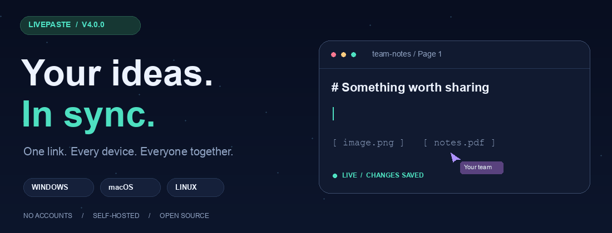
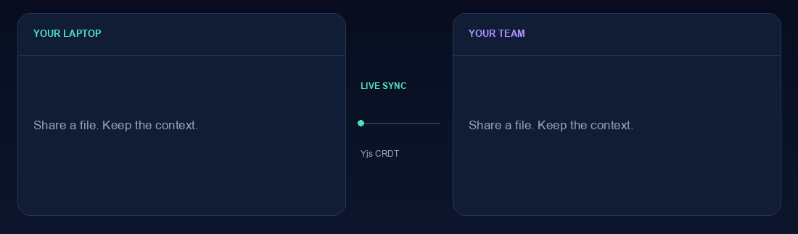
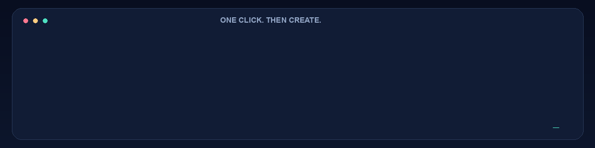
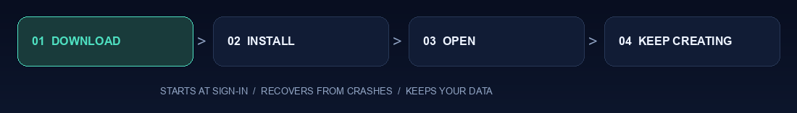
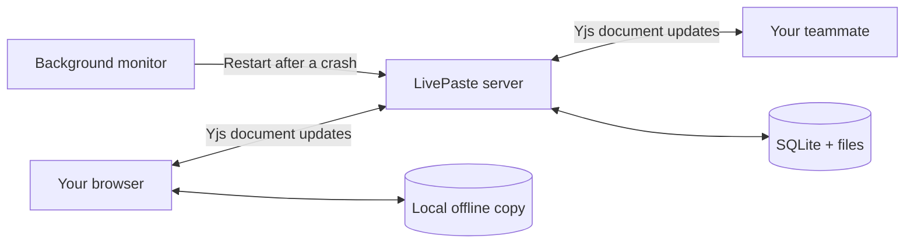

<div align="center">



**Your clipboard just became a shared workspace.**

Text, code, screenshots, files. One link. No accounts.

[](https://github.com/NakshtraYadav/Live-Paste/releases/tag/v4.0.0)
[](https://github.com/NakshtraYadav/Live-Paste/actions/workflows/ci.yml)
[](https://github.com/NakshtraYadav/Live-Paste/actions/workflows/security.yml)

### [⬇ Get LivePaste](#-get-livepaste) · [✦ Explore](#-built-for-the-moment) · [⚡ Windows setup](#-windows-one-click-setup) · [⌘ Commands](#-youre-in-control)

</div>

---

## ✦ Built for the moment

A screenshot for a teammate. A code snippet between laptops. Notes everyone can edit together. Open LivePaste, create a link, and keep going.



<table>
<tr>
<td width="33%"><h3>⚡ Together, instantly</h3>Concurrent editing, live cursors, presence and reactions. Every page keeps its own document history.</td>
<td width="33%"><h3>📎 Drop the whole thing</h3>Paste screenshots. Drop PDFs, archives, videos or any other file. Inline previews keep the context.</td>
<td width="33%"><h3>🔗 One link, your rules</h3>Read-only sharing, secret edit links, individual editor grants, password locks, expiry and burn-after-read.</td>
</tr>
<tr>
<td><h3>↻ Pick up where you left off</h3>Edits mirror to local browser storage. Reconnects exchange document state and acknowledge saved changes.</td>
<td><h3>▤ Make room for ideas</h3>Named pages, revisions and restore, syntax highlighting, Markdown and HTML previews, find and replace.</td>
<td><h3>⌂ Yours to run</h3>Self-host on Windows, macOS or Linux. Persistent SQLite storage by default. No signup service required.</td>
</tr>
</table>

## ⬇ Get LivePaste

| Your computer | Download | Start |
| :--- | :--- | :--- |
| **Windows 10 / 11 · x64** | **[One-click Setup.exe](https://github.com/NakshtraYadav/Live-Paste/releases/download/v4.0.0/livepaste-windows-x86_64-setup.exe)** | Open setup. LivePaste installs, starts and opens your browser. |
| **macOS · Apple Silicon** | [Mac ARM64](https://github.com/NakshtraYadav/Live-Paste/releases/download/v4.0.0/livepaste-macos-arm64) | `chmod +x livepaste-macos-arm64 && ./livepaste-macos-arm64 start` |
| **macOS · Intel** | [Mac x64](https://github.com/NakshtraYadav/Live-Paste/releases/download/v4.0.0/livepaste-macos-x86_64) | `chmod +x livepaste-macos-x86_64 && ./livepaste-macos-x86_64 start` |
| **Linux · x64** | [Linux x64](https://github.com/NakshtraYadav/Live-Paste/releases/download/v4.0.0/livepaste-linux-x86_64) | `chmod +x livepaste-linux-x86_64 && ./livepaste-linux-x86_64 start` |
| **Linux · ARM64** | [Linux ARM64](https://github.com/NakshtraYadav/Live-Paste/releases/download/v4.0.0/livepaste-linux-arm64) | `chmod +x livepaste-linux-arm64 && ./livepaste-linux-arm64 start` |

**No Python needed for these downloads.** Every release includes [SHA256SUMS](https://github.com/NakshtraYadav/Live-Paste/releases/download/v4.0.0/SHA256SUMS). A portable [Windows executable](https://github.com/NakshtraYadav/Live-Paste/releases/download/v4.0.0/livepaste-windows-x86_64.exe) is also available.

<details>
<summary><strong>Prefer a terminal? macOS / Linux installer and Python install</strong></summary>

```bash
curl -fsSL https://raw.githubusercontent.com/NakshtraYadav/Live-Paste/main/install.sh | bash
livepaste start
```

Or, with **Python 3.11+**:

```bash
python -m pip install "git+https://github.com/NakshtraYadav/Live-Paste.git@v4.0.0"
livepaste start
```

Open **http://localhost:8090**. The terminal also shows a LAN address for other devices on your network. A saved custom port takes precedence over 8090.

</details>

## ⚡ Windows: one-click setup



**Download → open setup → start sharing.** No terminal, Python install or administrator account required.

- **Ready now:** setup starts LivePaste and opens your default browser.
- **Ready next time:** it starts automatically when you sign in to Windows.
- **Keeps running:** a background monitor restarts the server after a crash, with a single-instance lock to prevent competing servers.
- **Keeps your work:** upgrades and uninstalls preserve the saved database and attachments.
- **Easy to reopen:** click **LivePaste** on your desktop or in the Start menu.
- **Easy to stop:** choose **Stop LivePaste** in the Start menu; reopen LivePaste to start it again.



The background app runs **while your computer is awake and you are signed in**. Sign-in startup can be disabled with `autostart disable`. Network access from other devices depends on your Windows Firewall/private-network settings. Setup does not change firewall rules.

<details>
<summary><strong>Windows commands, storage and updates</strong></summary>

Setup installs into `%LOCALAPPDATA%\Programs\LivePaste`. Your settings, database and uploads live in `%USERPROFILE%\.livepaste` unless you configure a different data folder.

```powershell
$lp = "$env:LOCALAPPDATA\Programs\LivePaste\livepaste.exe"
& $lp status
& $lp background --open
& $lp stop
& $lp autostart disable
& $lp autostart enable
& $lp update
```

Windows updates download and verify the versioned installer, then safely stop, upgrade and restart the app. For a previous Windows release, use `rollback v<version>` when that release includes a Windows installer. Settings and saved pastes stay in place.

</details>

## ⌘ You're in control

| Do this | Command |
| :--- | :--- |
| Run in a terminal | `livepaste start` |
| Keep running in the background | `livepaste background` |
| Start in the background and open the editor | `livepaste background --open` |
| See what's running | `livepaste status` |
| Stop without deleting your work | `livepaste stop` |
| Restart safely | `livepaste restart` |
| Start at sign-in | `livepaste autostart enable` |
| Disable sign-in startup | `livepaste autostart disable` |
| Change the default port | `livepaste config port 9000` |
| Check for updates | `livepaste update --check` |
| Install a release update | `livepaste update` |

On Windows, use the installed executable as shown above. On macOS, sign-in startup uses a LaunchAgent; Linux uses a systemd user service.

**Persistent by default.** `start --ephemeral` explicitly clears local data at startup and graceful exit. Use it only for disposable sessions.

## ✧ The little things add up

**⌘ / Ctrl + K** command palette · **⌘ / Ctrl + H** find and replace · QR sharing · Dark mode · Auto language detection · Named pages · Revision diffs · Safe Markdown previews · Sandboxed HTML previews · Clipboard images · Audio, video and PDF previews

<details>
<summary><strong>Experimental browser features</strong></summary>

WebRTC peer-to-peer sync, screen/voice capture and in-browser JavaScript/Python execution depend on browser capabilities. Recording and encrypted P2P may require HTTPS or localhost. The server-backed sync path remains available. Offline recovery is tested with controlled outages; browser storage limits and private browsing can affect retention.

See [feature maturity](FEATURE_AUDIT_REPORT.md), the [repair evidence](REPAIR_REPORT.md) and the [reference guide](docs/REFERENCE.md) for details.

</details>

## ◈ Built to stay in sync



React + Vite on the front. FastAPI, Yjs and SQLite behind it. Optional MongoDB storage and Redis coordination for hosted deployments. Standalone apps bundle their Python runtime and the production frontend.

## 🛠 Build, test, contribute

```bash
python3 -m venv .venv
# macOS/Linux: source .venv/bin/activate
# Windows:    .venv\Scripts\Activate.ps1
python -m pip install -e . pytest httpx build
python -m pytest tests/ -q
yarn --cwd frontend install --frozen-lockfile
yarn --cwd frontend test
yarn --cwd frontend sync
python scripts/check_bundle.py
```

[Contributing](CONTRIBUTING.md) · [API & CLI reference](docs/REFERENCE.md) · [Changelog](CHANGELOG.md) · [Security model](AUDIT.md) · [Report a bug](https://github.com/NakshtraYadav/Live-Paste/issues)

GitHub Actions tests Python 3.11 and 3.14 on Windows and Linux. Release builds test native apps, background crash recovery, and the Windows setup/upgrade/uninstall flow before publishing assets and checksums.

<details>
<summary><strong>Release checks and animation sources</strong></summary>

Update `VERSION`, `CHANGELOG.md` and the service-worker cache version together. Rebuild bundled assets, run `./scripts/release.sh --preflight`, commit reviewed changes on `main`, then use `./scripts/release.sh --publish`. Publication waits for all platform builds.

The four animations above are original, repository-hosted GIF illustrations. They need no JavaScript or external animation service. Regenerate them with `python scripts/render_readme.py` after installing Pillow; Pillow is only an illustration tool, not an app dependency. The frames illustrate workflows rather than recording the live UI.

</details>

---

<div align="center">

**Paste something. Make it happen.**

Made by [Nakshtra Yadav](https://github.com/NakshtraYadav) · Open source · Self-hosted · **v4.0.0**

</div>
