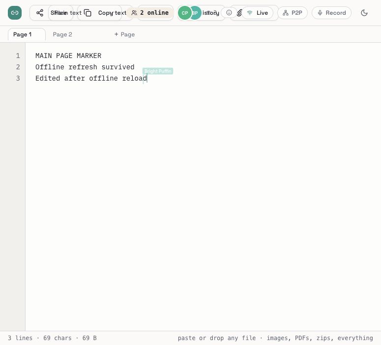

# LivePaste 3.18.1 reliability repairs

This is the reliability repair baseline incorporated into **4.0.0**. The
installation observations below describe the earlier local 3.18.1 cutover;
the v4 release adds Windows installation and background monitoring. See
[Windows support](docs/WINDOWS.md) and the current changelog for that scope.

12 November 2026. Repairs prepared on `fix/reliability-root-causes` for `main`.

The original 18 findings in [BUG_AUDIT.md](BUG_AUDIT.md) are addressed. The
main repair makes the Yjs document the durable source of truth: text backups,
page changes, uploads, reloads and reconnections use the same document history.
A connection reports Live only after pending edits receive a storage acknowledgement.

## Findings and fixes

| Audit findings | Root repair | Verification |
| --- | --- | --- |
| B01, refresh grants | Keep participant identity through refresh; return capabilities only to authenticated sockets; target grants by connection session; send actual permissions privately. | Capability impersonation and reconnect tests; a granted editor refreshed and remained editable in a real browser. |
| B02, B06 | Give each page its own document; merge durable IndexedDB state; exchange state vectors; retry unacknowledged edits; reject stale socket callbacks. Make page switching atomic and wait for initial page state before editing. | Two independent browser origins edited offline together and converged; offline reload and subsequent editing also converged; page isolation remained intact. |
| B03 | Permit viewers to request page state without opening write access. | Backend viewer-state regression and installed-program smoke test. |
| B04, B05 | Merge CRDT history rather than slicing dependent updates; derive backups from canonical state; restore by editing that same state. Archive broken legacy history before recovering its last durable text backup. | Concurrent merge/restore tests; real SQLite/Yjs replay retains all 1,005 characters on both main and secondary pages. |
| B07 | Run code in dedicated worker files with worker-specific policies; keep the application policy strict and bound execution/output. | Installed worker-policy checks; JavaScript Run executed successfully in the browser. |
| B08–B10 | Share password checks and lockout across content and metadata reads; preserve long passwords and use a compatible password KDF. | Password guessing, long-password and locked-page metadata regressions. |
| B11, B12 | Count anonymous burn reads; remove revisions, all page state and recovery archives during ephemeral cleanup. | Backend burn and purge regressions. |
| B13 | Recheck paste expiry/existence for socket writes, uploads and downloads. | Expired-socket regression and backend file authorization tests. |
| B14–B16 | Persist verified launch settings; preserve host, port, data directory and persistence flags on restart; never kill arbitrary port users; honor explicit keep-data. | CLI regressions; clean wheel and standalone binary restart tests with custom storage. |
| B17 | Observe incoming document updates directly so image references render immediately. | Real clipboard image paste appeared in both browser sessions; component regression uses real Yjs updates. |
| B18 | Choose video MIME types for screen capture and audio types for voice; handle recorder startup failures. | Recorder-hook regression. Actual capture remains browser/hardware dependent. |

Additional repairs cover delayed upload completion on the original page,
durable upload sync after navigation, failed-delete references, absolute file
URLs, private file caching, range downloads, page-cache identity after slug
reuse, presence metadata and expired file access. Encrypted P2P keys are scoped
to actual editors and rotate when grants change.

## Checks performed

- Backend: **79 passed**; frontend: **13 passed**, with no expected-failure markers.
- Frontend production build, complete bundled-asset comparison and Python compilation passed.
- Release preflight passed. The wheel and native macOS ARM64 executable passed installed-program tests: packaged assets, worker policies, CRDT persistence, viewer reads, Unicode binary uploads/downloads, byte ranges and restart with custom data settings.
- The fixed SQLite replay recovered **1,005/1,005 characters** from compacted history on both page types. The deliberately destructive history-deletion control still recovers zero, showing why truncation cannot be used.
- Production frontend and installed Python dependency audits reported **zero known advisories** at verification time. Bandit reported zero medium/high findings at the configured confidence threshold.
- Browser checks used separate `127.0.0.1` and `localhost` origins, disposable data and a controlled server interruption. Both sessions preserved concurrent offline edits and the secondary-page image. A cold offline reload retained editing; further edits reached both sessions when service returned. Switching back to the secondary page showed its original content without main-page contamination.

Evidence and machine-readable results are under [audit/2026-11-12/fixed](audit/2026-11-12/fixed).

## Installation and release

Version and changelog are prepared together as **3.18.1**. Python installations
now require **3.11+**; standalone executables include their runtime. The installed
copy has been upgraded separately from the development checkout. The normal
`livepaste` command reports 3.18.1, and the running server's version and health
endpoints confirm 3.18.1 on its original port **65535** and data directory.
All **28** attachment files match the cutover backup byte for byte. Database,
attachment, configuration and previous-environment backups are retained under
the installation's `backups/pre-3.18.1-cutover-*` directory. The isolated QA
server has been stopped; the installed server remains running.

The release workflow now gates publication on tests and security checks, builds
the frontend from source, packages the native CRDT dependency, smoke-tests each
binary and uses current macOS runner labels. Downloads require a checksum from
the same pinned release tag. `scripts/release.sh` defaults to validation and
requires an explicit publish action on a clean, reviewed main branch.

The 3.18.1 source changes include the version bump and release preparation.
Publishing a GitHub release is a separate step: push a reviewed version tag
after the source checks pass, then verify every platform build and its assets.

## Validation limits

The controlled outage exercises disconnect, retries, offline persistence and
recovery; the machine's Wi-Fi was not disabled. Live MongoDB/Redis deployments,
multiple server workers, mobile Safari, physical screen/microphone capture,
Python runtime loading and the other release-platform binaries need their own
environment checks. The frontend still emits its existing large-bundle warning.
No audit can establish the absence of every possible bug.

Old state already destroyed by earlier versions cannot be recreated. Recovery
keeps the last durable text and archives remaining legacy bytes; unrelated
browser-cache identities are retained as recovery copies instead of silently
merged into a new paste. Local offline copies remain on their browser by design.
